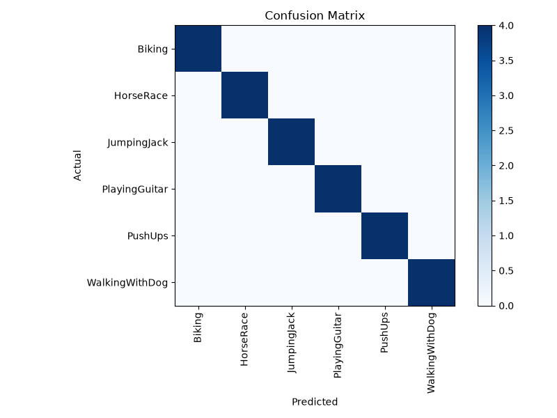

# ActionSense: Human Action Recognition from Video

ActionSense recognizes human actions in video clips. A pretrained MobileNetV2 turns video frames into feature vectors, and an LSTM classifies the sequence into an action. A small Flask web app lets you upload a video and see the predicted action with a confidence score for each class.

It also includes **open-set rejection**: if a video shows an action the model was never trained on, it is flagged as "not a trained action" instead of being forced into the nearest known class.

## Features

- Video action classification with a MobileNetV2 + LSTM model (TensorFlow / Keras)
- Open-set rejection using per-class centroids and distance thresholds on the LSTM's embedding layer
- Flask web UI: upload a video, see the prediction and score bars for every class
- REST endpoints for programmatic use
- Scripts for feature extraction, training and real-time inference
- Runs on CPU only, no GPU needed

## How it works

1. **Frame sampling and feature extraction:** frames are sampled from each video and passed through MobileNetV2 (without its classifier head), giving a 1280-dimensional feature vector per frame.
2. **Sequence model:** the sequence of feature vectors goes into an LSTM network (64 and 32 units, dropout 0.3, learning rate 0.001, the best settings found during tuning) that predicts the action class.
3. **Open-set check:** the embedding from the LSTM is compared with each class's centroid. If it is too far from all of them, the video is rejected as an unfamiliar action.

## Dataset

Trained on a subset of the **UCF50** action recognition dataset: 6 classes (Biking, HorseRace, JumpingJack, PlayingGuitar, PushUps, WalkingWithDog), 20 videos per class. The dataset is not included in this repository.

## Tech stack

Python 3.11, TensorFlow / Keras, OpenCV, Flask, NumPy, scikit-learn, matplotlib, tqdm

## Project structure

```
ActionSense/
├── app.py                   # Flask web app and API
├── src/
│   ├── extract_features.py  # frame sampling and MobileNetV2 feature extraction
│   ├── train_model.py       # LSTM training
│   ├── predict_video.py     # predict the action in a video
│   └── realtime_inference.py
├── models/
│   ├── action_recognition_model.keras   # trained model
│   ├── labels.json                      # class names
│   ├── open_set_profile.json            # centroids and thresholds for rejection
│   ├── best_config.json                 # best hyperparameters
│   └── confusion_matrix.png
├── requirements.txt
└── .gitignore
```

## Getting started

The trained model is included, so you can run the app without any training.

1. Clone the repository
   ```bash
   git clone https://github.com/Sahana138/ActionSense.git
   cd ActionSense
   ```
2. Create and activate a virtual environment
   ```bash
   python -m venv venv
   venv\Scripts\activate        # Windows
   source venv/bin/activate     # Linux / macOS
   ```
3. Install dependencies
   ```bash
   pip install -r requirements.txt
   ```
4. Start the app
   ```bash
   python app.py
   ```
5. Open `http://localhost:5000` in your browser, upload a short video, and see the prediction.

## API endpoints

| Method | Route | Purpose |
|---|---|---|
| GET | `/` | Web interface |
| GET | `/health` | Health check |
| POST | `/preview` | Used by the web UI when a video is uploaded |
| POST | `/predict` | Upload a video and get the predicted action with class scores |

## Retraining

The training data is not included. To retrain:

1. Download the UCF50 dataset and place the videos for the six classes in `data/`.
2. Extract features: `python src/extract_features.py`
3. Train the model: `python src/train_model.py`

Training writes the model, labels and open-set profile into `models/`.

## Results

Confusion matrix on the evaluation data:



## Limitations

- Only 6 action classes, trained on a small number of videos per class.
- Open-set rejection uses distance thresholds, so very similar unseen actions can still be mistaken for a known class.
- Trained and tested on CPU only, so inference on long videos can be slow.

## Future work

More action classes and more training data, a lighter or faster model for real-time use, and smarter threshold calibration for rejecting unfamiliar actions.